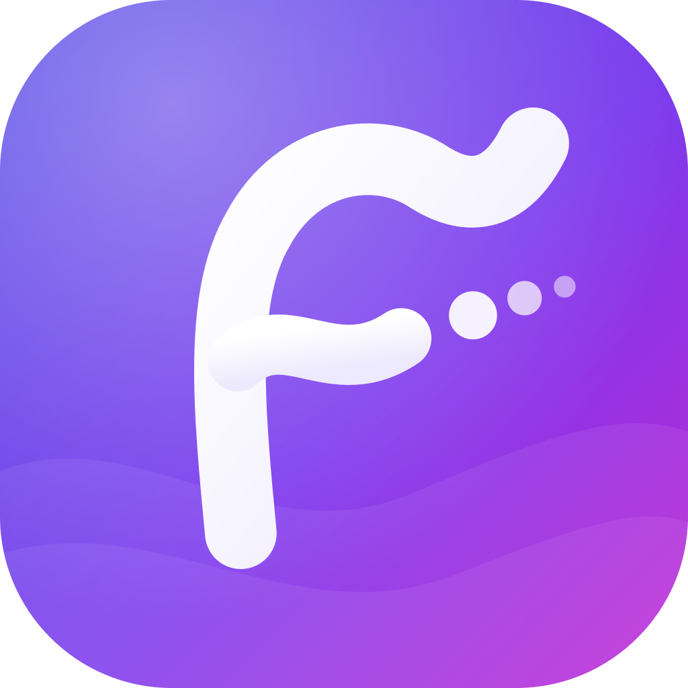

<p align="center">
  
</p>

<h1 align="center">Flowed</h1>
<p align="center"><b>Plan · Focus · Flow</b><br>A student planner that lives on your phone, works offline, and needs no account.</p>

<p align="center">
  <a href="https://YOUR-SITE.netlify.app"><b>Open Flowed →</b></a>
</p>

---

## Overview

Flowed keeps a student's whole semester in one place: classes, assignments, quizzes, exams, study sessions and goals. It tells you what needs attention before it becomes a problem.

- **Offline:** everything is stored **on your device**. There is no sign-up, no cloud and no ads.
- **Installable:** after the first visit it opens and works with no internet, like a regular app.
- **Smart, without AI or the internet:** it suggests what to work on next, warns about heavy days, tracks your study streak, and builds a catch-up plan when you fall behind.

| | What you get |
|---|---|
| **Dashboard** | Today's classes, what's due, upcoming exams, progress and a "work on next" list |
| **Tasks** | Assignments, projects, quizzes and to-dos, with checklists, priorities, due dates and countdowns |
| **Quick add** | Type `Essay fri 5pm #ENG101 !high` and Flowed fills in the date, subject and priority |
| **Class schedule** | Weekly timetable with overlap warnings and a free-time finder |
| **Import schedule from a photo** | Snap or screenshot your class schedule and Flowed reads it into your timetable |
| **Exams** | Countdown, venue and a preparation checklist |
| **Calendar** | Month, week and day views of everything |
| **Heads-up** | Alerts for overdue work, deadlines coming up, classes about to start and exams soon |
| **Focus timer** | Pomodoro sessions with stats and a study streak |
| **Analytics & weekly review** | Completion rate, focus hours, workload per subject, and weekly goals |

## Get Flowed

Open **https://YOUR-SITE.netlify.app** and add it to your Home Screen. It installs in seconds and is free.

### iPhone / iPad
1. Open the link in **Safari** (other browsers on iPhone can't install apps).
2. Tap **Share** <sub>(the square with an arrow)</sub> → **Add to Home Screen** → **Add**.
3. Open **Flowed** from your Home Screen once while online. After that it works offline.

### Android
1. Open the link in **Chrome**.
2. Tap **⋮** → **Add to Home screen** (or **Install app**) → **Install**.

### Computer (Windows, Mac, Chromebook)
Open the link in Chrome or Edge, then click the **install icon** in the address bar (or **⋮ → Install Flowed**). It also works in any browser tab.

> Always open Flowed from its icon, not a browser tab, so your phone treats it as an installed app and keeps its data.

## Start in 5 minutes

1. **Settings → Profile:** enter your name, course and year.
2. **Class schedule → Import:** take a photo or pick a screenshot of your class schedule. Check the classes it found, then tap **Import**. (You can also add classes one by one.)
3. **Tasks:** type into the quick-add bar, e.g. `Lab report fri 5pm #CS201 !high`, and press Enter.
4. **Exams:** add your exam dates and a checklist of what to review.
5. **Bell icon (Heads-up):** tap **Allow notifications** for pop-up alerts while Flowed is open.
6. **Settings → Calendar sync → Add to Calendar:** your phone's Calendar will remind you about classes, deadlines and exams **even when Flowed is closed**.
7. **Settings → Export backup:** save a copy to iCloud Drive or Google Drive now and then.

The full how-to for every feature is in **[docs/USER-GUIDE.md](docs/USER-GUIDE.md)**.

## Your data & privacy

- Your data stays **on your device**. Nothing is uploaded, shared or tracked. The website only delivers the app itself.
- **Deleting the Home Screen icon deletes its data** (on iPhone). Export a backup first.
- To move to a new phone: **Export backup** on the old one, then **Choose backup file…** on the new one.

## FAQ

**Do I need internet?** Only the first time you open it (and the first time you scan a schedule photo, about 6 MB). After that, no.

**Will I get reminders when the app is closed?** Use **Settings → Calendar sync**. Your phone's Calendar app then delivers the reminders. While Flowed is open, its own heads-up alerts pop up.

**Does it cost anything?** No.

**How do I update it?** Updates arrive automatically. Open Flowed while online, then close and reopen it.

---

## For developers

Flowed is a Next.js static export, packaged for Android and iOS with Capacitor.

| Where | Storage | Reminders |
|---|---|---|
| Android / iOS app (Capacitor) | **SQLite** via `@capacitor-community/sqlite` | OS-scheduled local notifications |
| Web / Home Screen app | **IndexedDB** via `idb`, offline via a service worker | In-app heads-up + calendar (.ics) export |

Stack: Next.js (App Router, `output: "export"`), React, TypeScript, Tailwind CSS, shadcn/ui (Base UI), Zod + React Hook Form, date-fns, Recharts, tesseract.js (offline OCR), Three.js (opening animation), Capacitor 8.

### Quick start

Requirements: **Node.js 22+** (the tests use the built-in `node:sqlite`).

```bash
npm install
npm run dev          # http://localhost:3000
```

| Script | What it does |
|---|---|
| `npm run build` | Static export to `out/` plus offline service worker (what you deploy / Capacitor ships) |
| `npm run deploy:netlify` | Build and deploy `out/` to Netlify (`npx netlify-cli login` once first) |
| `npm test` | Unit and contract tests (Vitest); the repository suite runs against **both** SQLite and IndexedDB |
| `npm run test:e2e` | Browser smoke test of `out/` in installed Edge/Chrome (`BROWSER_CHANNEL=chrome` to switch) |
| `npm run test:offline` | Loads once, cuts the network, checks every page and edit still works |
| `npm run test:features` | Intro, photo import with real OCR (also offline), quick add, heads-up, text size, .ics export, 375px overflow |
| `npm run test:all` | All of the above, plus typecheck and lint |
| `npm run android:apk` | Build web, sync, assemble a debug APK |
| `npm run android:open` / `ios:open` | Build web, sync, open Android Studio / Xcode |
| `npm run icons` / `npm run assets` | Regenerate icons from `resources/brand/flowed-mark.svg` / native icons and splash screens |

### Project structure

```
src/
  app/                    Routes (all client-rendered, statically exported)
    page.tsx              Dashboard
    tasks/ calendar/ subjects/ schedule/ exams/ focus/ analytics/ review/ settings/
  components/
    brand/                Logo (FlowedMark) and the Three.js opening intro
    heads-up/             Alert engine provider, bell, panel, dashboard banner
    schedule/             Photo/text schedule import dialog (OCR + review)
    ui/                   shadcn/ui primitives (Base UI)
    shell/app-shell.tsx   Sidebar, mobile header, bottom nav + "More" sheet
    editors/              Create/edit dialogs (RHF + Zod) opened via useEditors()
    providers/            DbProvider + useLiveQuery, SettingsProvider, NativeBridge, offline support
    focus/ settings/ shared/ tasks/ charts/
  lib/
    db/                   schema.ts, repositories.ts, sqlite/ and indexeddb/ backends + migrations
    alerts.ts             Heads-up engine and free-time finder (pure, unit-tested)
    schedule-import.ts    Schedule text parser for OCR / pasted text
    quick-add.ts          Natural-language task parser
    ics.ts backup.ts notifications.ts insights.ts calendar.ts dates.ts files.ts intro.ts
tests/                    Vitest suites (+ node:sqlite test driver)
scripts/                  build steps (OCR assets, service worker, icons) and E2E suites
resources/                Logo master + sources for native icons and splash screens
android/ ios/             Capacitor native projects
```

### Documentation

- [docs/USER-GUIDE.md](docs/USER-GUIDE.md): how to use every feature
- [docs/IPHONE-WEB-APP.md](docs/IPHONE-WEB-APP.md): hosting and installing the offline web app
- [docs/MOBILE.md](docs/MOBILE.md): Android APK and iOS/Xcode builds
- [docs/DATABASE.md](docs/DATABASE.md): architecture, schema, migrations
- [docs/BACKUP.md](docs/BACKUP.md): backup file format and import rules
- [docs/TESTING.md](docs/TESTING.md): automated tests and the device checklist
